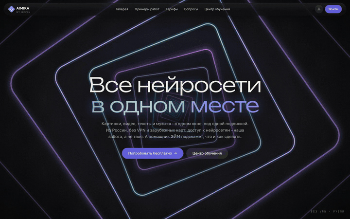
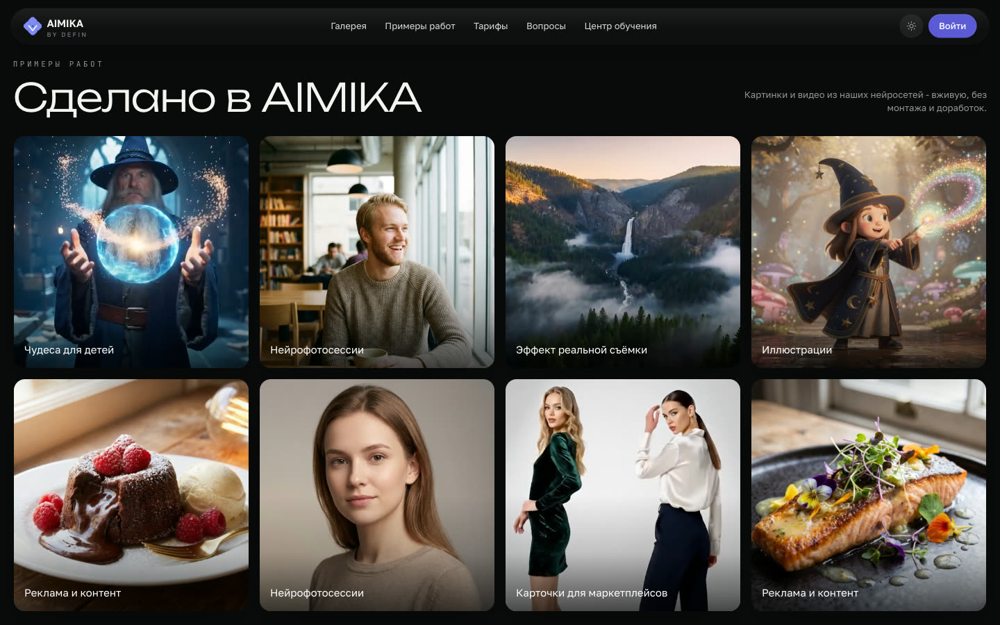
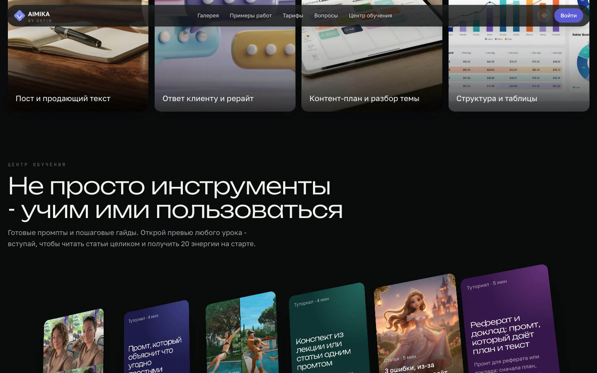
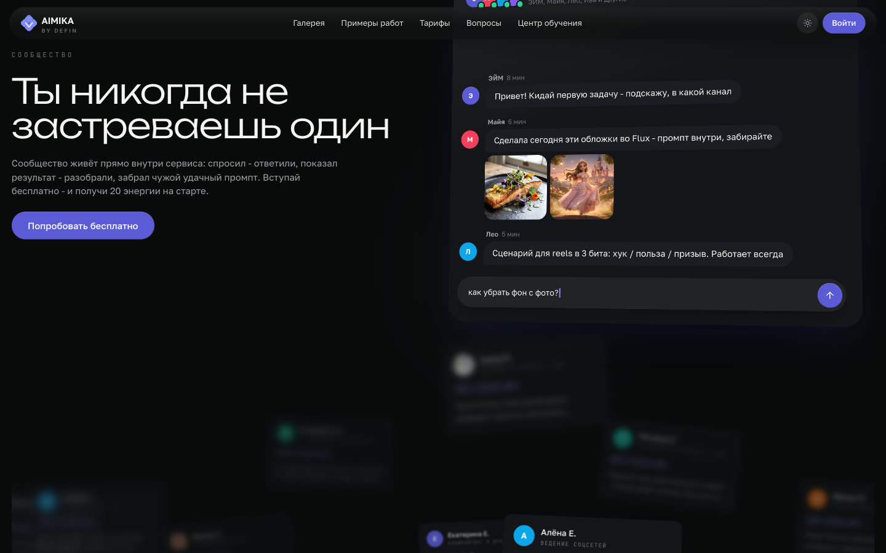
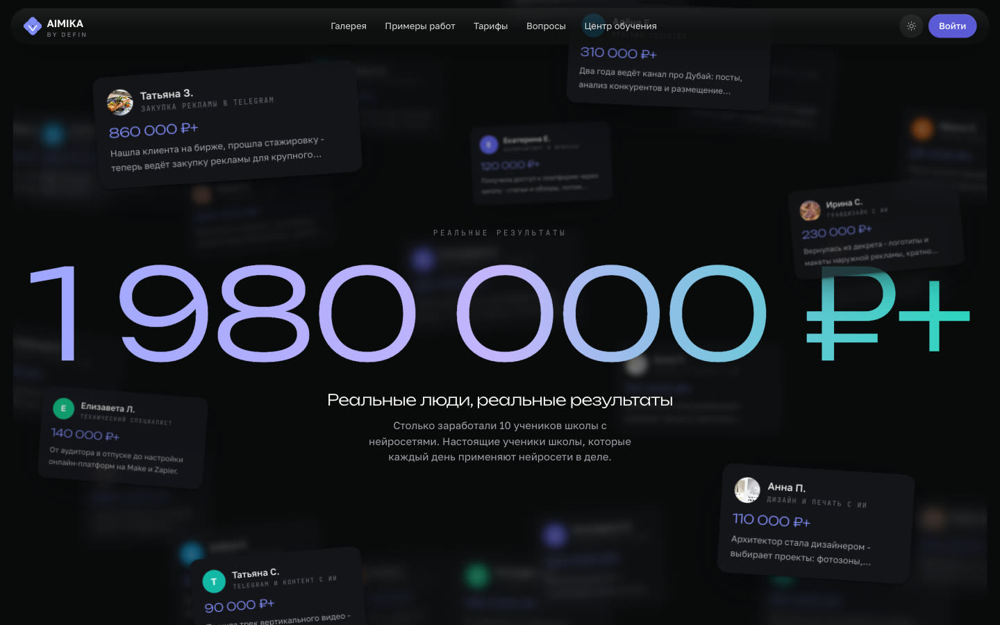
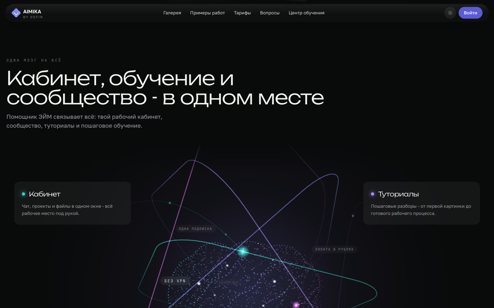
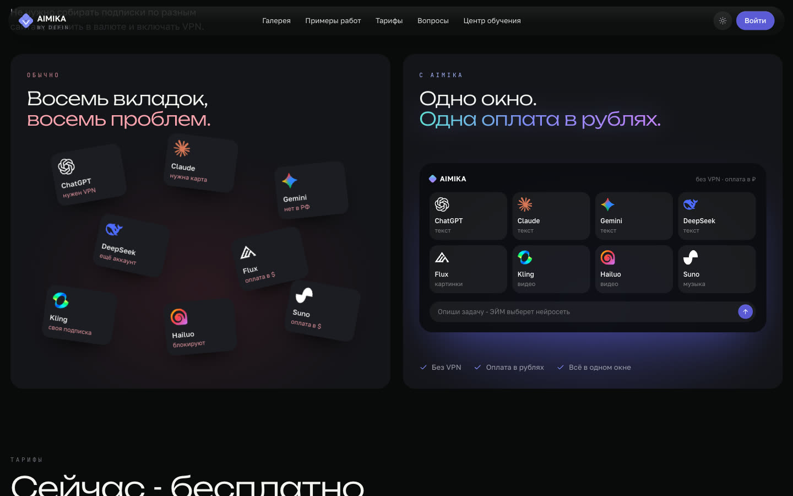
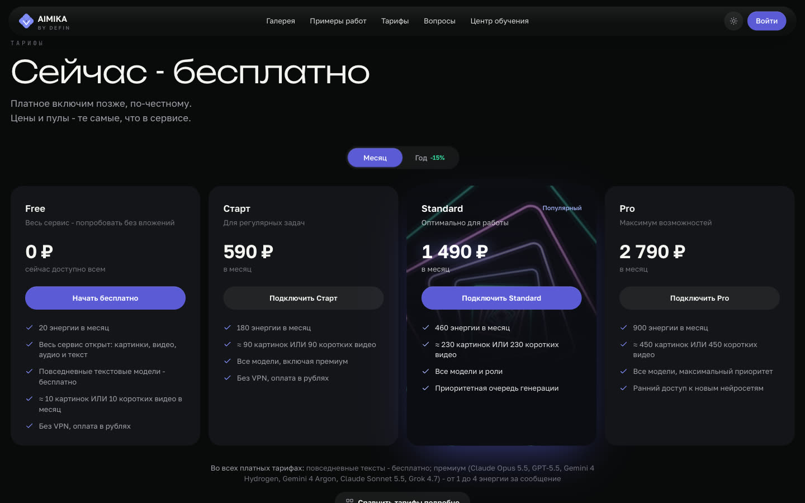
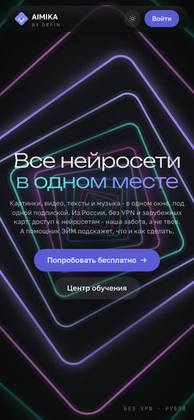

# AIMIKA — редизайн лендинга

**Живой сайт: [aimika.space](https://aimika.space/)**

AIMIKA — агрегатор нейросетей: картинки, видео, тексты и музыка в одном окне, под одной подпиской, без VPN и с оплатой в рублях. Я сделал редизайн главной страницы: дизайн, анимации и фронтенд. Заказчик принял работу и выложил её в прод в ноябре 2026.

> Это витрина проекта. Исходный код принадлежит заказчику, поэтому здесь только описание и скриншоты.

## Что сделано

**Неоновый туннель на первом экране.** Из глубины спиралью летят светящиеся рамки в цветах логотипа. При прокрутке восемь из них «остывают» и превращаются в карточки галереи работ. Точка схода следует за курсором с лёгкой пружиной, а по клику расходится ударная волна. Тем же туннелем страница и заканчивается.

**Вступление при загрузке.** Сначала дожидаемся шрифтов, чтобы заголовок не прыгал. Потом туннель «прилетает», строки по очереди проявляются из размытия, последней выезжает шапка.

**Веер уроков в перспективе.** Карточки центра обучения стоят веером в 3D и слегка поворачиваются за мышью. При наведении карточка выезжает вперёд.

**Живой чат сообщества.** Сообщения появляются по одному, есть индикатор «печатает…». Своё сообщение набирается по буквам и улетает в ленту. Слои окна разнесены по глубине и наклоняются за курсором.

**Облако отзывов.** В центре крупная сумма, которую заработали ученики школы, вокруг на трёх планах глубины плавают их карточки: чем больше результат, тем ближе и крупнее карточка.

**Экосистема в 3D.** Мозг собран из точек по контуру и извилинам, вокруг вращаются неоновые орбиты. Он связывает кабинет, обучение, сообщество и туториалы.

**Хаос и порядок.** Вместо таблицы сравнения две половины. Слева восемь разрозненных сервисов, у каждого своя проблема. Справа те же сервисы собраны в одном окне продукта.

**Плавная прокрутка колесом** без сторонних библиотек. На тачпаде и тачскрине остаётся нативная прокрутка.

## Скриншоты

| | |
|---|---|
|  |  |
|  |  |
|  |  |
|  |  |

## Производительность

- Вес страницы снижен с 6,9 до 3,2 МБ, первая загрузка — с 2,2 до 0,95 МБ. Для этого пережаты картинки и видео.
- LCP ≈ 0,14 с, CLS 0,008 (прод-сборка).
- Без горизонтальной прокрутки на ширине от 360 до 1920 px. Есть светлая тема.

## Стек

Next.js 14 (App Router), React 18, TypeScript, Tailwind CSS. Все анимации написаны на Canvas 2D, CSS 3D-трансформациях и requestAnimationFrame, без новых зависимостей и анимационных библиотек.

---

© 2026. Дизайн и код принадлежат владельцу AIMIKA. Скриншоты приведены для портфолио.
